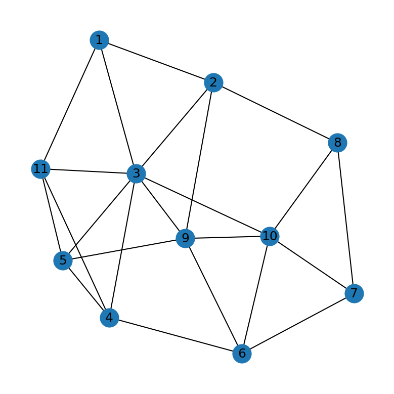

# Network Reliability Optimisation

**Which nodes should a telecom operator protect to keep two sites connected when routers fail?**


---

## The problem

A telecommunications network has 11 nodes and 23 links. Traffic must get from **node 10 (source)** to **node 11 (sink)**. Any of the 9 routers in between can fail. The operator can afford to **harden 2 nodes** so they never fail. Which ones?

<p align="center"></p>

## The answer

> **Harden node 3.** It alone takes connectivity from **99.916% to 100%**, because node 3 links directly to both the source and the sink.
> **Use the second unit on node 9.** It raises the expected number of independent routes from 3.36 to 3.45, the best of any pair.

---

## How it works

### 1. Base case: how many independent routes are there?

Each node is split into an "in" and an "out" copy joined by a link of capacity 1. By Menger's theorem, the maximum flow in this graph equals the number of **node-disjoint paths**, meaning routes that share no router.

**Result: 4 node-disjoint paths**, so the network survives any 3 failures.

| Path | Route |
|---|---|
| 1 | 10 → 3 → 11 |
| 2 | 10 → 6 → 4 → 11 |
| 3 | 10 → 9 → 5 → 11 |
| 4 | 10 → 8 → 2 → 1 → 11 |

Removing any single router except node 7 drops the count from 4 to 3. So the deterministic model shows the network is robust, but it can't tell you which node matters most.

### 2. Extension: how likely is the network to stay connected?

Each router fails independently with probability **p = 0.10**. With 9 routers there are **2⁹ = 512 failure scenarios**. Each one is solved exactly with max flow and weighted by its probability.

| Metric | Value |
|---|---|
| Probability source stays connected to sink | **0.999160** (99.916%) |
| Expected number of node-disjoint paths | **3.256** |
| Scenarios that disconnect the network | 120 of 512 |
| Fewest failures needed to disconnect | 4 |

Every one of the 120 disconnecting scenarios includes node 3. Most involve many simultaneous failures, so together they carry only a 0.084% chance.

### 3. Hardening: where to spend the budget

Hardening a node sets its failure probability to 0. Every set of up to 2 nodes is evaluated exactly.

**Best single nodes**

| Hardened | P(connected) | Expected paths |
|---|---|---|
| **3** | **1.000000** | **3.356** |
| 9 | 0.999639 | 3.347 |
| 4 | 0.999558 | 3.346 |
| 6 | 0.999558 | 3.346 |
| 5 | 0.999485 | 3.339 |

**Best pairs**

| Hardened | P(connected) | Expected paths |
|---|---|---|
| **3, 9** | **1.000000** | **3.447** |
| 3, 4 | 1.000000 | 3.446 |
| 3, 6 | 1.000000 | 3.446 |
| 4, 6 | 1.000000 | 3.446 |
| 3, 5 | 1.000000 | 3.439 |

**Why node 3:** it is the most connected router (7 links) and the only one adjacent to both node 10 and node 11. Once it can't fail, the path 10 → 3 → 11 is always available. Nodes 4 and 6 together also guarantee connectivity, through 10 → 6 → 4 → 11, but that takes the whole budget to achieve what node 3 does alone.

---

## Why the extension matters

| | Deterministic model | Probabilistic model |
|---|---|---|
| Question answered | Can the network survive *k* failures? | How likely is it to stay connected? |
| Treats scenarios | All equally | Weighted by probability |
| Guides investment | No, every node looks similar | Yes, ranks nodes by reliability gained |

## Run it

```bash
pip install -r requirements.txt
python network_reliability.py              # summary
python network_reliability.py --scenarios  # also writes all 512 scenarios to results/
```

The full run takes about 15 seconds.

**Outputs in [`results/`](results)**
- `hardening_single.csv`: connectivity and expected paths for each single node
- `hardening_pairs.csv`: the same for all 36 pairs
- `all_scenarios.csv`: every failure scenario with surviving paths, an example route and its probability

## Notes

- Completed for MIS41160 Optimisation in Business at UCD Michael Smurfit Graduate Business School.
- The failure probability (0.10) and budget (2) are set at the top of `network_reliability.py`, so other scenarios are a one-line change.

---

**Sudarshan Ellora** · [Portfolio](https://www.sudarshanellora.com/) · [LinkedIn](https://linkedin.com/in/sudarshane) · [GitHub](https://github.com/sudarshanellora)
